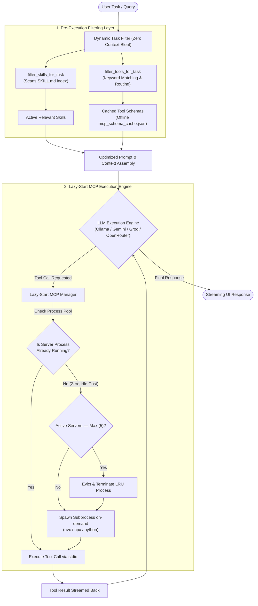

# ALP (Agentic Local Processing) Terminal

<p align="center">
  <strong>The Sovereign, Zero-Telemetry Desktop Terminal Connecting Local Ollama & Cloud LLMs Directly to MCP Tools.</strong>
</p>

<p align="center">
  <b>English 🇬🇧</b> • <a href="README.tr.md"><b>Türkçe 🇹🇷</b></a>
</p>

<p align="center">
  <a href="https://github.com/netizen4-bit/alpai/releases"></a>
  <a href="https://github.com/netizen4-bit/alpai/blob/main/LICENSE"></a>
  <a href="https://www.patreon.com/netizen4_bit"></a>
  <a href="https://www.linkedin.com/in/nihatkasim"></a>
</p>

<p align="center">
  <a href="#-why-alp-terminal-the-sovereignty-advantage">Why ALP?</a> •
  <a href="#-architecture-comparison">Comparison</a> •
  <a href="#-key-features">Key Features</a> •
  <a href="#-installation-guide">Installation</a> •
  <a href="#-cloud-ai-provider-setup-api-keys">Cloud AI Setup</a> •
  <a href="#-connecting-mcp-servers">Connecting MCP Tools</a> •
  <a href="#-support-the-project">Support</a> •
  <a href="#-license">License</a>
</p>

---

## Download latest release

🔗 **[Download latest Windows Setup Wizard & macOS DMG (v1.5)](https://github.com/netizen4-bit/alpai/releases/tag/v1.5)**

---

## ⚡ Why ALP Terminal? (The Sovereignty Advantage)

Contemporary agentic platforms (such as Hermes or OpenClaw) force users into bloated Docker containers, mandatory telemetry tracking, cloud account lock-in, and remote file processing. For confidential enterprise operations, competitive intelligence, and OSINT reconnaissance, this compromises your security.

**ALP (Agentic Local Processing) Terminal** is built on a simple philosophy: **Zero setup. Zero telemetry. Absolute local sovereignty.**

- **Single Lightweight Executable (< 25 MB):** No Docker daemons, no Node.js runtime bloat, no background services.
- **Native Host Rendering:** Powered by `pywebview`, utilizing Microsoft Edge WebView2 on Windows and WebKit on macOS for hardware-accelerated, native rendering.
- **Offline & Air-Gapped Ready:** Run fully offline using local Ollama models (via WSL or native localhost) with automatic sliding context window optimization.
- **Universal FastMCP Engine:** 1-Click install and bind any Model Context Protocol tool directly from GitHub or package runners (`uvx`, `npx`).

---

## 📊 Architecture Comparison

| Architectural Vector | Cloud Agents (Hermes, OpenClaw, etc.) | ALP Terminal |
| :--- | :--- | :--- |
| **Telemetry & Tracking** | ❌ Continuous prompt tracking & user telemetry | ✅ **Zero telemetry.** 100% private, air-gapped ready. |
| **Runtime Footprint** | ❌ Heavy Docker images / 500MB+ Electron containers | ✅ **Single lightweight installer (< 25 MB)** |
| **Deployment Model** | ❌ Complex docker-compose, port forwarding, config scripts | ✅ **Standard ready-to-run installers (`.exe` wizard / `.dmg`)** |
| **Tool Protocol** | ⚠️ Proprietary wrappers or restricted sandboxes | ✅ **Universal Model Context Protocol (FastMCP)** |
| **Local LLM Performance** | ⚠️ High CPU lag on multi-turn history | ✅ **Sliding context optimizer for Ollama / WSL** |
| **Host System Integration** | ❌ Filesystem mount friction inside containers | ✅ **Native document ingestion (.pdf, .docx, .csv, .txt)** |
| **Data Storage** | ❌ Cloud-synced databases | ✅ **Persistent local JSON in user home directory (`~/.alp_terminal`)** |

---

## 🧠 Scaled Execution Architecture: Lazy-Start & Dynamic Filtering

When scaling to dozens or hundreds of connected MCP servers (150–200+ tools), conventional agent frameworks crash or suffer extreme latency from resource exhaustion and prompt context overflow. ALP Terminal solves this through a three-tier execution pipeline:



### Architectural Highlights
1. **Lazy-Start & Offline Schema Cache (`mcp_schema_cache.json`)**:
   - **Zero Idle Overhead:** Tool definitions are cached locally during initial registration. Even with 150+ tools configured, ALP starts up in **< 0.05 seconds with 0 background processes running**.
   - **On-Demand Subprocess Spawning:** Background processes (`uvx`, `npx`, `python`) are only launched at the exact millisecond an LLM calls that specific tool.
   - **LRU Process Pool Management:** ALP caps concurrent active subprocesses at a maximum of 5. The least-recently-used server is automatically terminated when a new one is needed, preserving host RAM and CPU.
2. **Dynamic Tool Filtering (`filter_tools_for_task`)**:
   - Instead of injecting hundreds of tools into the LLM system prompt (which degrades attention and exhausts token limits), ALP dynamically matches and supplies only tools relevant to the active prompt.
3. **Dynamic Skill Filtering (`filter_skills_for_task`)**:
   - Ingests and indexes installed `SKILL.md` documents, routing only the relevant domain procedures (e.g. ATS screening, OSINT dorking, bibliometrics) into the execution context.

---

## 🚀 Key Features

### 1. Multi-Provider Fallback & Sliding Context Window
- **Hybrid Brain Architecture:** Switch freely between local hardware execution and frontier cloud models.
- **Local Ollama Speed Optimization:** Built-in sliding context window specifically tuned for 3B–8B local models (`alp-brain:latest`, `qwen2.5`, `llama3`). Automatically truncates multi-turn tool history to eliminate CPU prompt-evaluation freezing.
- **Automatic Quota Rotation:** Seamless failover across Gemini free-tier rotation, GroqCloud (200+ tok/s high-speed inference), and OpenRouter when rate limits occur.

### 2. 1-Click FastMCP Auto-Installer & Binder
- **Zero-Friction Tooling:** Paste any GitHub repository URL, raw script Gist, or package runner command directly into the settings pane.
- **Automated Windows Path Resolution:** Handles Windows `.CMD` / `.BAT` batch script boundaries for `npx`, and auto-bootstraps missing package managers (`uv`, `uvx`) on-the-fly via pip.
- **Scientific Cold-Start Tolerance:** Features an extended 45-second JSON-RPC handshake timeout engineered for servers importing heavy scientific C-extensions (`numpy`, `pandas`, `scipy`, `statsmodels`).

### 3. Domain-Agnostic Skill Engine (`SKILL.md`)
- Automatically discovers, ingests, and mounts `SKILL.md` instructions found inside connected repositories or the local `skills/` folder.
- Enforces strict procedural steps on both local and cloud models (e.g., 4-Tier ATS filtering, OSINT recon workflows, academic bibliometrics).

### 4. Zero-Leak Document Processing
- Native, in-memory text extraction for `.pdf`, `.docx`, `.txt`, `.csv`, and `.md` attachments directly into prompt context without external cloud parsers.

---

## 📦 Installation Guide

ALP Terminal is distributed as pre-compiled standalone installers. No Python environment, Git installation, or setup scripts are needed.

### Windows (`.exe` Setup Wizard)
1. Download **[`ALP_Setup_Win64.exe`](https://github.com/netizen4-bit/alpai/releases/download/v1.5/ALP_Setup_Win64.exe)** from **[Release v1.5](https://github.com/netizen4-bit/alpai/releases/tag/v1.5)**.
2. Run the installer wizard to complete installation (Desktop and Start Menu shortcuts are created automatically).
3. *(Optional for Local AI)* Ensure [Ollama](https://ollama.com/) is running either on Windows or inside WSL (`ollama serve`).

### macOS (`.dmg` Drag-and-Drop)
1. Download **[`ALP_Mac_Installer.dmg`](https://github.com/netizen4-bit/alpai/releases/download/v1.5/ALP_Mac_Installer.dmg)** from **[Release v1.5](https://github.com/netizen4-bit/alpai/releases/tag/v1.5)**.
2. Open the disk image and drag **ALP Terminal** (`ALP_Terminal_Mac.app`) into your `/Applications` directory.
3. **First-Time Launch (Apple Gatekeeper Verification):**
   Because ALP Terminal is distributed directly without Apple's commercial developer fee certificate, macOS Gatekeeper may show a warning on first launch: *"ALP_Terminal_Mac can't be opened because Apple cannot check it for malicious software"*. You only need to approve it **once** using any of the following methods:
   - **Method 1 (Recommended - 2 Clicks):** Open your `/Applications` folder in Finder. **Right-click (or Control-click)** on `ALP_Terminal_Mac` and select **Open**. In the confirmation dialog, click **Open**.
   - **Method 2 (System Settings):** If you attempted to launch and saw the warning dialog, go to **Apple Menu  > System Settings > Privacy & Security**. Scroll down to the *Security* section where it notes *"ALP_Terminal_Mac was blocked"*, and click **Open Anyway**.
   - **Method 3 (Terminal One-Liner):** Remove the browser quarantine attribute directly via Terminal:
     ```bash
     xattr -cr /Applications/ALP_Terminal_Mac.app
     ```
   *After this initial approval, ALP Terminal opens normally on every subsequent launch.*

---

## 🔑 Cloud AI Provider Setup (API Keys)

ALP Terminal runs local Ollama models offline and connects seamlessly to cloud LLMs. You can obtain free API keys from the following providers:

| Provider | API Key Portal | Format / Prefix |
| :--- | :--- | :--- |
| **Google AI Studio** | [Google AI Studio API Keys](https://aistudio.google.com/app/apikey) | `AIzaSy...` |
| **Groq (GroqCloud)** | [Groq Console Keys](https://console.groq.com/keys) | `gsk_...` |
| **OpenRouter** | [OpenRouter Keys](https://openrouter.ai/keys) | `sk-or-...` |

### Installing API Keys in ALP:
1. Open ALP Terminal and click the **Settings (Gear Icon ⚙️)** in the top header.
2. In the **🤖 LLM Connections** tab, enable the checkbox for your provider (**Google Gemini**, **GroqCloud**, or **OpenRouter**).
3. Paste your API key into the corresponding **API Key** input field.
4. Select your preferred model or keep the default **⚡ Auto Rotation**.
5. Click **Connect / Verify** to test the connection and save your configuration.

---

## 🔌 Connecting MCP Servers

Transform any Model Context Protocol repository into an active agent capability in under 10 seconds:


1. Click the **Settings (Gear Icon)** in the top header.
2. Navigate to the **Active MCP Servers** tab.
3. In the **1-Click FastMCP Auto-Installer** box, paste any supported source:

### Verified MCP Tools Ready for ALP

| Domain | Repository / Command | Description |
| :--- | :--- | :--- |
| **Academic Research** | `https://github.com/netizen4-bit/scholar_direct` | Automated literature search, bibliometric gap analysis, and APA-7 formatting. |
| **B2B Lead Hunting** | `https://github.com/netizen4-bit/leaddirect-mcp` | DuckDuckGo dorking, domain MX recon, and zero-bounce SMTP verification. |
| **Job Market Intelligence** | `https://github.com/netizen4-bit/jobs-direct` | 4-Tier ATS job-fit evaluation, resume tailoring, and interview prep. |
| **Web Content Scraping** | `uvx mcp-server-fetch` | Official MCP HTML-to-Markdown web page content extractor. |
| **Time & Timezones** | `uvx mcp-server-time` | Official IANA timezone conversion and system time tools. |

---

## ☕ Support the Project

ALP Terminal is an independently developed, sovereign tool designed for users who value local control, privacy, and deterministic agentic execution. 

If ALP saves you time, accelerates your research, or powers your confidential business operations, consider supporting ongoing development:

<p align="center">
  <a href="https://www.patreon.com/netizen4_bit">
    
  </a>
</p>

* 💖 **Support Open Development on Patreon:** [patreon.com/netizen4_bit](https://www.patreon.com/netizen4_bit)
* 💼 **Professional & Enterprise Inquiries:** [LinkedIn (Nihat Kasim)](https://www.linkedin.com/in/nihatkasim)

Your support helps fund continuous testing across Windows/macOS environments, model context optimization, and the expansion of the FastMCP ecosystem.

---

## 📄 License

ALP Terminal is distributed under the **Apache License 2.0**. See the [LICENSE](https://github.com/netizen4-bit/alpai/blob/main/LICENSE) file for details.

Copyright © 2026 [netizen4-bit](https://github.com/netizen4-bit). All rights reserved.
