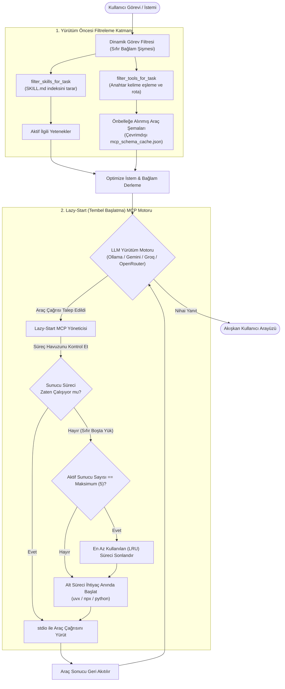
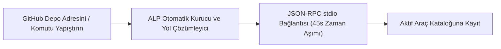

# ALP (Agentic Local Processing) Terminal

<p align="center">
  <strong>Yerel Ollama ve bulut yapay zeka modellerini doğrudan MCP araçlarına bağlayan, veri toplamayan (telemetrisiz) masaüstü terminali.</strong>
</p>

<p align="center">
  <a href="README.md"><b>English 🇬🇧</b></a> • <b>Türkçe 🇹🇷</b>
</p>

<p align="center">
  <a href="https://github.com/netizen4-bit/alpai/releases"></a>
  <a href="https://github.com/netizen4-bit/alpai/blob/main/LICENSE"></a>
  <a href="https://www.patreon.com/netizen4_bit"></a>
  <a href="https://www.linkedin.com/in/nihatkasim"></a>
</p>

<p align="center">
  <a href="#-neden-alp-terminal-yerel-kontrol-ve-gizlilik">Neden ALP?</a> •
  <a href="#-mimari-karşılaştırma">Karşılaştırma</a> •
  <a href="#-temel-özellikler">Temel Özellikler</a> •
  <a href="#-kurulum-rehberi">Kurulum</a> •
  <a href="#-bulut-yapay-zeka-sağlayıcılarını-yapılandırma-api-anahtarları">Bulut AI Kurulumu</a> •
  <a href="#-mcp-sunucularını-bağlama">MCP Araçlarını Bağlama</a> •
  <a href="#-projeye-destek-olun">Destek</a> •
  <a href="#-lisans">Lisans</a>
</p>

---

## Güncel Sürümü İndir

🔗 **[En son Windows ve macOS kurulum dosyalarını indirin (v1.5)](https://github.com/netizen4-bit/alpai/releases/tag/v1.5)**

---

## ⚡ Neden ALP Terminal? (Yerel Kontrol ve Gizlilik)

Mevcut otonom ajan platformlarının çoğu (Hermes, OpenClaw vb.) kullanıcıları ağır Docker konteynerlerine, zorunlu veri takibine (telemetri), bulut hesaplarına ve dosyaları harici sunucularda işlemeye yönlendirir. Gizlilik gerektiren iş süreçleri, şirket içi veriler ve OSINT araştırmaları için bu durum güvenlik riski oluşturur.

**ALP (Agentic Local Processing) Terminal** net bir yaklaşımla geliştirilmiştir: **Sıfır kurulum karmaşası. Sıfır telemetri. Tam yerel kontrol.**

- **Hafif Kurulum Dosyası (< 25 MB):** Docker servisine, Node.js bağımlılığına veya arka planda çalışan servislere ihtiyaç duymaz.
- **İşletim Sistemine Uygun Yerel Arayüz:** `pywebview` altyapısı ile Windows üzerinde Microsoft Edge WebView2, macOS üzerinde WebKit kullanarak donanım hızlandırmalı sade bir arayüz sunar.
- **Çevrimdışı ve İzole Çalışma:** WSL veya yerel Ollama modelleriyle internet bağlantısına gerek kalmadan çalışır; bağlam penceresini otomatik yönetir.
- **Evrensel FastMCP Motoru:** Model Context Protocol (MCP) araçlarını GitHub bağlantısı veya paket çalıştırıcılar (`uvx`, `npx`) üzerinden tek tıkla sisteme bağlar.

---

## 📊 Mimari Karşılaştırma

| Kriter | Bulut Tabanlı Ajanlar (Hermes, OpenClaw vb.) | ALP Terminal |
| :--- | :--- | :--- |
| **Telemetri ve Takip** | ❌ İstemler (prompt) ve kullanıcı hareketleri kaydedilir | ✅ **Sıfır telemetri.** Tamamen gizli, izole ortama uygun. |
| **Sistem Yükü** | ❌ Ağır Docker imajları / 500 MB+ Electron uygulamaları | ✅ **Hafif kurulum dosyası (< 25 MB)** |
| **Kurulum Modeli** | ❌ docker-compose, port yönlendirme, karmaşık ayarlar | ✅ **Standart hazır kurulum (`.exe` / `.dmg`)** |
| **Araç Protokolü** | ⚠️ Özel kütüphaneler veya kısıtlı ortamlar | ✅ **Evrensel Model Context Protocol (FastMCP)** |
| **Yerel Model Performansı** | ⚠️ Uzun sohbet geçmişinde CPU kilitlenmesi | ✅ **Ollama / WSL için kayan bağlam penceresi optimizasyonu** |
| **Dosya Entegrasyonu** | ❌ Konteyner içine dosya bağlama (mount) zorluğu | ✅ **Doğrudan yerel belge işleme (.pdf, .docx, .csv, .txt)** |
| **Veri Depolama** | ❌ Bulut veritabanları | ✅ **Kullanıcı dizininde yerel JSON formatında depolama (`~/.alp_terminal`)** |

---

## 🧠 Ölçeklenebilir Yürütüm Mimarisi: Lazy-Start & Dinamik Filtreleme

Sisteme bağlanan MCP sunucusu ve araç sayısı onlarca veya yüzlerceye (150–200+ araç) ulaştığında, geleneksel yapay zeka ajanları aşırı bellek tüketimi ve bağlam penceresi şişmesi nedeniyle kilitlenir. ALP Terminal, bu sorunu üç aşamalı optimize bir yürütüm mimarisiyle çözer:



### Öne Çıkan Mimari Yetenekler
1. **Lazy-Start (Tembel Başlatma) & Çevrimdışı Şema Önbelleği (`mcp_schema_cache.json`)**:
   - **Sıfır Boşta Kaynak Tüketimi:** Araç şemaları ilk kayıtta yerel JSON önbelleğine alınır. Sistemde 150+ araç tanımlı olsa bile ALP **0 arka plan süreciyle < 0.05 saniyede** anında açılır.
   - **İhtiyaç Anında Başlatma (On-Demand Spawning):** Arka plan araç süreçleri (`uvx`, `npx`, `python`), yalnızca LLM o aracı gerçekten çağırdığı milisaniyede ayağa kaldırılır.
   - **LRU Süreç Havuzu Yönetimi:** ALP, aynı anda bellekte tutulan aktif MCP sunucu sayısını en fazla 5 ile sınırlar. Yeni bir araç gerektiğinde en uzun süredir kullanılmayan sunucu otomatik kapatılır; bilgisayarınızın RAM ve CPU kaynakları asla tükenmez.
2. **Dinamik Araç Filtreleme (`filter_tools_for_task`)**:
   - Yüzlerce aracın şemasını doğrudan isteme yığarak modelin mantığını bulandırmak ve token kotasını doldurmak yerine, ALP kullanıcının görev istemiyle yalnızca örtüşen araçları dinamik olarak seçip modele sunar.
3. **Dinamik Yetenek Filtreleme (`filter_skills_for_task`)**:
   - Yüklü `SKILL.md` prosedürlerini indeksler; prompt ile eşleşen alan kurallarını (ATS analizi, OSINT dorking vb.) seçici olarak bağlama ekler.

---

## 🚀 Temel Özellikler

### 1. Çoklu Sağlayıcı ve Kayan Bağlam Penceresi
- **Hibrit Yapı:** Yerel donanımınızda çalışan modeller ile bulut modelleri arasında serbestçe geçiş yapın.
- **Yerel Ollama Hız Optimizasyonu:** 3B–8B parametreli yerel modeller (`alp-brain:latest`, `qwen2.5`, `llama3`) için özel kayan bağlam optimizasyonu. Çok turlu araç geçmişini otomatik kırparak işlemcinin (CPU) kilitlenmesini engeller.
- **Otomatik Kota Geçişi:** Hız sınırı (rate limit) aşıldığında Gemini ücretsiz kotası, GroqCloud (200+ tok/s hızlı çıkarım) ve OpenRouter arasında kesintisiz yedekli geçiş.

### 2. Tek Tıkla FastMCP Otomatik Kurucu
- **Kolay Araç Kurulumu:** Herhangi bir GitHub depo adresini, betik bağlantısını veya komutunu ayarlar panelindeki kutuya yapıştırmanız yeterlidir.
- **Windows Yol Çözümleme:** Windows üzerindeki `.CMD` / `.BAT` komut dosyalarını (`npx`) sorunsuz çalıştırır; sistemde bulunmayan paket yöneticilerini (`uv`, `uvx`) pip aracılığıyla otomatik kurar.
- **Bilimsel Kütüphaneler İçin 45 Saniyelik Zaman Aşımı:** Ağır C-uzantıları (`numpy`, `pandas`, `scipy`, `statsmodels`) kullanan MCP sunucularının ilk açılış gecikmelerini karşılamak için 45 saniyelik JSON-RPC el sıkışma süresi tanır.

### 3. Alana Özgü Yetenek Motoru (`SKILL.md`)
- Bağlanan depolardaki veya yerel `skills/` klasöründeki `SKILL.md` yönergelerini otomatik olarak tespit eder, okur ve sisteme dahil eder.
- Hem yerel hem de bulut modellerin belirli iş akışı adımlarına (örneğin ATS işe alım filtreleme, OSINT istihbarat adımları, akademik literatür analizi) adım adım uymasını sağlar.

### 4. Güvenli Belge İşleme
- `.pdf`, `.docx`, `.txt`, `.csv` ve `.md` eklerindeki metinleri harici bulut servislerine göndermeden, doğrudan yerel bellekte çıkararak model bağlamına aktarır.

---

## 📦 Kurulum Rehberi

ALP Terminal derlenmiş standart kurulum dosyalarıyla dağıtılır. Python, Git veya ek bir geliştirme ortamı kurmanız gerekmez.

### Windows (`.exe` Kurulum Sihirbazı)
1. **[Sürüm v1.5](https://github.com/netizen4-bit/alpai/releases/tag/v1.5)** sayfasından **[`ALP_Setup_Win64.exe`](https://github.com/netizen4-bit/alpai/releases/download/v1.5/ALP_Setup_Win64.exe)** dosyasını indirin.
2. Kurulum sihirbazını çalıştırarak kurulumu tamamlayın (Masaüstü ve Başlat Menüsü kısayolları otomatik oluşturulur).
3. *(Yerel Model Kullanımı İçin - İsteğe Bağlı)* [Ollama](https://ollama.com/)'nın Windows üzerinde veya WSL içinde açık olduğundan emin olun (`ollama serve`).

### macOS (`.dmg` Disk İmajı)
1. **[Sürüm v1.5](https://github.com/netizen4-bit/alpai/releases/tag/v1.5)** sayfasından **[`ALP_Mac_Installer.dmg`](https://github.com/netizen4-bit/alpai/releases/download/v1.5/ALP_Mac_Installer.dmg)** dosyasını indirin.
2. İndirilen `.dmg` dosyasını açın ve **ALP Terminal** (`ALP_Terminal_Mac.app`) simgesini **Applications (Uygulamalar)** klasörüne sürükleyin.
3. **İlk Çalıştırma ve Apple Gatekeeper Onayı:**
   ALP Terminal, Apple'ın yıllık ücretli ticari geliştirici sertifikasına tabi olmayan bağımsız bir açık kaynak projesi olarak derlendiği için macOS Gatekeeper ilk açılışta *"ALP_Terminal_Mac kötü amaçlı yazılımlara karşı kontrol edilemediği için açılamıyor"* uyarısı verebilir. Bu onay **yalnızca ilk çalıştırmada bir defaya mahsus** aşağıdaki pratik yöntemlerden biriyle verilir:
   - **Yöntem 1 (Önerilen - 2 Tık):** **Applications (Uygulamalar)** klasörünü Finder'da açın. `ALP_Terminal_Mac` uygulamasına **Sağ Tıklayın (veya Control tuşuna basılı tutarak tıklayın)** ve **Aç (Open)** seçeneğini seçin. Açılan onay penceresinde tekrar **Aç (Open)** butonuna tıklayın.
   - **Yöntem 2 (macOS Sistem Ayarları):** Uygulamayı açmayı deneyip uyarı penceresini gördüyseniz, **Apple Menüsü  > Sistem Ayarları > Gizlilik ve Güvenlik** bölümüne gidin. Ekranı aşağı kaydırarak *Güvenlik* başlığı altında yer alan *"ALP_Terminal_Mac uygulamasının engellendiği"* uyarısının yanındaki **Yine de Aç (Open Anyway)** butonuna tıklayın.
   - **Yöntem 3 (Terminal Tek Satır Komut):** Terminal uygulamasını açarak indirme karantinasını tek satırla kaldırabilirsiniz:
     ```bash
     xattr -cr /Applications/ALP_Terminal_Mac.app
     ```
   *İlk onayın ardından ALP Terminal sonraki tüm açılışlarda standart bir şekilde çift tıklanarak doğrudan çalışacaktır.*

---

## 🔑 Bulut Yapay Zeka Sağlayıcılarını Yapılandırma (API Anahtarları)

ALP Terminal, yerel Ollama modellerini tamamen çevrimdışı çalıştırmanın yanı sıra bulut yapay zeka sağlayıcılarını da destekler. Ücretsiz API anahtarlarınızı aşağıdaki bağlantılardan edinebilirsiniz:

| Sağlayıcı | API Anahtarı Portalı | Format / Ön Ek |
| :--- | :--- | :--- |
| **Google AI Studio** | [Google AI Studio API Keys](https://aistudio.google.com/app/apikey) | `AIzaSy...` |
| **Groq (GroqCloud)** | [Groq Console Keys](https://console.groq.com/keys) | `gsk_...` |
| **OpenRouter** | [OpenRouter Keys](https://openrouter.ai/keys) | `sk-or-...` |

### API Anahtarlarını ALP'ye Ekleme:
1. ALP Terminal'i açın ve üst menüdeki **Ayarlar (Çark Simgesi ⚙️)** butonuna tıklayın.
2. **🤖 LLM Connections (LLM Bağlantıları)** sekmesinde kullanmak istediğiniz sağlayıcının (**Google Gemini**, **GroqCloud** veya **OpenRouter**) onay kutusunu işaretleyerek aktif edin.
3. Kopyaladığınız anahtarı ilgili **API Key** alanına yapıştırın.
4. İstediğiniz bir modeli seçin veya otomatik yedekleme için varsayılan **⚡ Auto Rotation** seçeneğini bırakın.
5. Bağlantıyı doğrulamak ve ayarları kaydetmek için **Connect / Verify** butonuna tıklayın.

---

## 🔌 MCP Sunucularını Bağlama

Herhangi bir Model Context Protocol (MCP) deposunu saniyeler içinde aktif bir ajan yeteneğine dönüştürün:



1. Üst menüdeki **Ayarlar (Çark Simgesi)** butonuna tıklayın.
2. **Active MCP Servers (Aktif MCP Sunucuları)** sekmesine geçin.
3. **1-Click FastMCP Auto-Installer** kutusuna desteklenen bir depo adresi veya komut girin.

### ALP ile Test Edilmiş Örnek MCP Araçları

| Alan | Depo / Komut | Açıklama |
| :--- | :--- | :--- |
| **Akademik Araştırma** | `https://github.com/netizen4-bit/scholar_direct` | Otomatik literatür taraması, bibliyometrik eksiklik analizi ve APA-7 formatlama. |
| **B2B Müşteri Tespiti** | `https://github.com/netizen4-bit/leaddirect-mcp` | DuckDuckGo dork aramaları, alan adı MX kayıtları ve e-posta SMTP doğrulama. |
| **İş ve Kariyer Analizi** | `https://github.com/netizen4-bit/jobs-direct` | 4 aşamalı ATS uyum değerlendirmesi, CV uyarlama ve mülakat hazırlığı. |
| **Web İçerik Kazıma** | `uvx mcp-server-fetch` | Web sayfalarını HTML'den Markdown formatına dönüştüren resmi MCP aracı. |
| **Saat ve Zaman Dilimleri** | `uvx mcp-server-time` | IANA zaman dilimi dönüşümleri ve sistem saati sağlayan resmi araç. |

---

## ☕ Projeye Destek Olun

ALP Terminal; yerel kontrole, veri gizliliğine ve kararlı ajan yürütümüne önem veren kullanıcılar için bağımsız olarak geliştirilmektedir.

ALP işlerinizi hızlandırıyor, araştırmalarınıza katkı sağlıyor veya süreçlerinizi kolaylaştırıyorsa geliştirmeye destek olabilirsiniz:

<p align="center">
  <a href="https://www.patreon.com/netizen4_bit">
    
  </a>
</p>

* 💖 **Patreon Üzerinden Bağımsız Geliştirmeyi Destekleyin:** [patreon.com/netizen4_bit](https://www.patreon.com/netizen4_bit)
* 💼 **Kurumsal ve Profesyonel İletişim:** [LinkedIn (Nihat Kasim)](https://www.linkedin.com/in/nihatkasim)

Desteğiniz; Windows ve macOS ortamlarında sürekli test yapılmasını, model bağlam optimizasyonlarını ve FastMCP ekosisteminin genişletilmesini finanse eder.

---

## 📄 Lisans

ALP Terminal, **Apache Lisansı 2.0** kapsamında dağıtılmaktadır. Detaylar için [LICENSE](https://github.com/netizen4-bit/alpai/blob/main/LICENSE) dosyasına göz atabilirsiniz.

Telif Hakkı © 2026 [netizen4-bit](https://github.com/netizen4-bit). Tüm hakları saklıdır.
